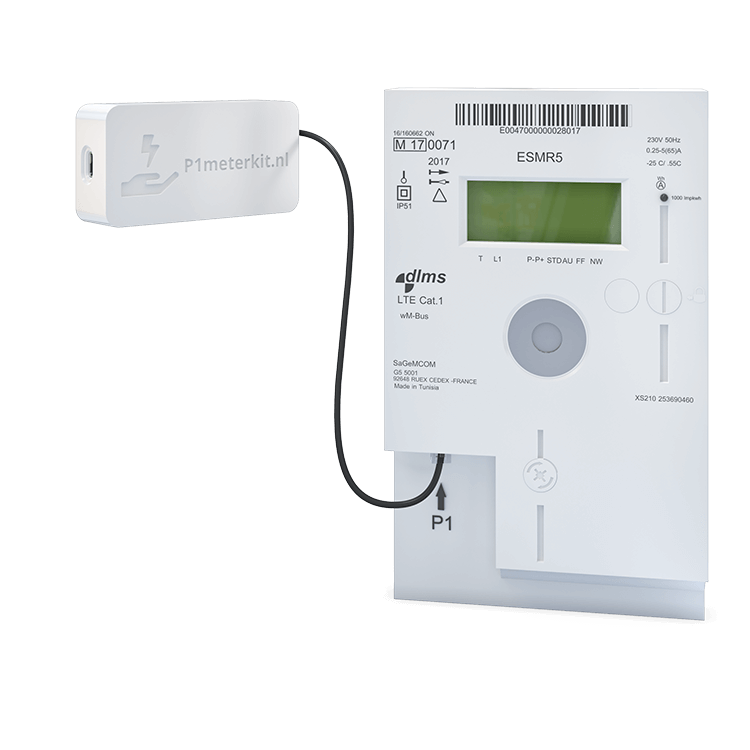

# P1MeterKit for Home Assistant / ESPHome



P1MeterKit is a compact ESPHome-based smart meter reader for Home Assistant. It reads DSMR telegrams from the P1 port and exposes electricity, gas, and environmental data locally through ESPHome, with optional SmartHomeShop cloud firmware variants.

Product page: https://p1meterkit.nl/en

## How It Works

P1MeterKit connects directly to the P1 port of a DSMR smart meter with an RJ12 cable. It reads incoming DSMR telegrams and publishes the data locally to Home Assistant through ESPHome.

## Key Features

- Real-time electricity consumption and production monitoring
- Gas monitoring through the meter's M-Bus data
- Voltage and current monitoring per phase
- Temperature and humidity sensing with HDC1080
- WiFi onboarding with captive portal fallback
- Fully local operation with Home Assistant and ESPHome
- Optional SmartHomeShop cloud sync firmware for each hardware revision

## Hardware Versions

| Version | Chip | Connectivity | Description |
|---------|------|--------------|-------------|
| V1 | ESP8266 | WiFi | Original compact P1MeterKit hardware |
| V2 | ESP32-C3 | WiFi | Updated hardware with Improv BLE and Improv Serial provisioning |
| V3 | ESP32-C6 | WiFi / Thread | ESP32-C6 hardware with local, cloud, and Thread firmware variants |

## Variants

We publish local WiFi and optional SmartHomeShop cloud firmware variants per hardware revision.

| Hardware | Variant | Description |
|----------|---------|-------------|
| V1 (ESP8266) | WiFi | Standard local WiFi firmware |
| V1 (ESP8266) | WiFi Cloud | WiFi firmware with SmartHomeShop cloud registration and telemetry sync |
| V2 (ESP32-C3) | WiFi | Standard local WiFi firmware with Improv BLE and Improv Serial |
| V2 (ESP32-C3) | WiFi Cloud | WiFi firmware with SmartHomeShop cloud registration and telemetry sync |
| V3 (ESP32-C6) | WiFi | Standard local WiFi firmware with Improv BLE and Improv Serial |
| V3 (ESP32-C6) | WiFi Cloud | WiFi firmware with SmartHomeShop cloud registration and telemetry sync |
| V3 (ESP32-C6) | Thread | Local Home Assistant firmware over the customer's existing Thread network |

## Getting Started

1. Connect the kit to the smart meter with the included RJ12 cable.
2. Flash the firmware with the web flasher or ESPHome CLI.
3. If WiFi is not configured yet, connect to the fallback hotspot.
4. On V2 and V3 hardware, you can also use Improv BLE or Improv Serial for provisioning.
5. Add the discovered ESPHome device to Home Assistant.

P1MeterKit V3 can also use the dedicated Thread package. Thread is local-only,
requires an existing Thread border router, and must be flashed over USB with
the network's Active Dataset TLVs. See the [Thread documentation](https://docs.smarthomeshop.io/en/p1meterkit/p1meterkit-thread-en).

Web flasher: https://smarthomeshop.io/en/firmware
Quick start guide: https://smarthomeshop.io/quick-start-p1meterkit

## Version History

- Customer-facing release notes: [CHANGELOG.md](CHANGELOG.md)
- GitHub Releases: https://github.com/smarthomeshop/p1meterkit/releases

## Repository Layout

```text
p1meterkit/
├── p1meterkit-v1/          # V1 ESP8266 ESPHome configurations
├── p1meterkit-v2/          # V2 ESP32-C3 ESPHome configurations
├── p1meterkit-v3/          # V3 ESP32-C6 ESPHome configurations
├── .github/workflows/      # Build and release automation
├── CHANGELOG.md            # Customer-facing firmware notes
└── images/
```

## Firmware Downloads

Pre-built firmware manifests are published on the `gh-pages` branch.

- V1 WiFi: `p1meterkit-v1-manifest.json`
- V1 WiFi Cloud: `p1meterkit-v1-cloud-manifest.json`
- V2 WiFi: `p1meterkit-v2-manifest.json`
- V2 WiFi Cloud: `p1meterkit-v2-cloud-manifest.json`
- V3 WiFi: `p1meterkit-v3-manifest.json`
- V3 WiFi Cloud: `p1meterkit-v3-cloud-manifest.json`

Thread firmware is configured per installation and is published as an ESPHome
package rather than a shared pre-built binary.

## Sensors

| Sensor | Description |
|--------|-------------|
| Energy Consumed Tariff 1/2 | Total energy consumed per tariff |
| Energy Produced Tariff 1/2 | Total energy returned per tariff |
| Power Consumed | Current electricity usage |
| Power Produced | Current electricity production |
| Voltage Phase 1/2/3 | Voltage per phase |
| Current Phase 1/2/3 | Current per phase |
| Gas Consumed | Total gas consumption |
| Temperature | Environment temperature |
| Humidity | Environment humidity |
| WiFi Signal | WiFi signal strength |

## DSMR Notes

P1MeterKit supports DSMR v4/v5 style P1 telegrams. The gas meter M-Bus channel can differ per installation; V3 defaults to M-Bus ID 2 to match the ESP32-C6 hardware test configuration.

V1, V2 and V3 use a 4096-byte UART receive buffer and a matching DSMR telegram buffer to accommodate larger Belgian Fluvius telegrams. Increasing these RAM buffers does not add flash writes. Custom ESP8266 builds should account for the additional runtime heap required by the larger buffers.

## Contributing

PRs and issues are welcome. Please keep changes modular and follow ESPHome best practices.

## Support

- Product info and guides: https://p1meterkit.nl/en
- Store: https://smarthomeshop.io
- Community and support: https://smarthomeshop.io/discord

## License

This project is released under the CC BY-NC 4.0 license.

## Home Assistant API encryption

The firmware supports a unique API encryption key provisioned at runtime. No shared key is compiled into manufacturer firmware. Until a key is provisioned, unencrypted clients can connect; compatible Home Assistant versions can automatically provision a key and then use encrypted connections. Other native API clients must use the same key once encryption is active.

Runtime-provisioned keys survive reboots and normal manufacturer OTA updates that preserve preferences, provided the target firmware also supports runtime API encryption. Factory resets, erased preferences, or firmware without encryption support do not provide this guarantee.

A key previously compiled into a custom YAML configuration is not automatically copied into runtime storage. Moving from a YAML key to manufacturer firmware requires a one-time provisioning/reconfiguration step; entering a key only in a Home Assistant connection form does not write it to the device. Keep using ESPHome Device Builder updates if that migration has not been completed.

This setting controls the local native ESPHome API. SmartHomeShop Cloud uses its separate HTTP token authentication. See the [ESPHome API documentation](https://esphome.io/components/api/#configuration-variables).
